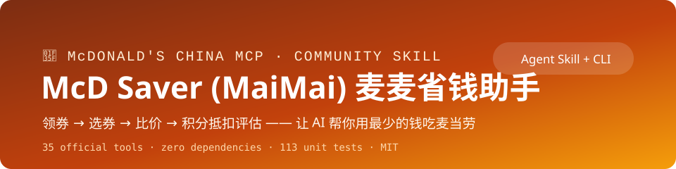
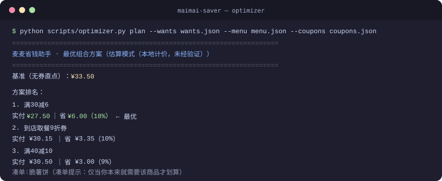
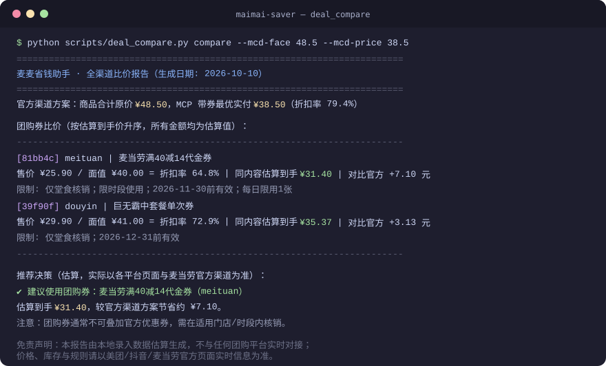

<div align="center">

# 🍟 MaiMai Saver (麦麦省钱助手)



**Let AI get you McDonald's for less** — Agent Skill + standalone CLI in one repo

Built on McDonald's China official MCP Server (integration guide:
[M-China/mcd-mcp-server](https://github.com/M-China/mcd-mcp-server)), covering
**35 official tools** across stores, menus, ordering, orders, coupons, points
mall, lottery and themed events.

**Core methodology**: before every order, a mandatory **4-step money-saving
check** — claim coupons → pick coupons → dual-price comparison → points
redemption evaluation. Every quote comes with a savings breakdown
(list price / discount / payable / saved).

[](https://yuxinlaile.github.io/maimai-saver/demo.html)
[](https://github.com/yuxinlaile/maimai-saver/releases/tag/v1.3.0)

-green)


[简体中文](README.md) · English

</div>

---

## Table of contents

- [Project overview](#project-overview)
- [Disclaimer](#disclaimer)
- [Core features](#core-features)
- [Tool coverage](#tool-coverage)
- [Tech stack](#tech-stack)
- [Target users](#target-users)
- [Sample output](#sample-output)
- [Repository layout](#repository-layout)
- [Requirements](#requirements)
- [Installation](#installation)
  - [Get an MCP Token](#get-an-mcp-token)
  - [Option A: connect via an MCP client](#option-a-connect-via-an-mcp-client)
  - [Option B: install as an Agent Skill](#option-b-install-as-an-agent-skill)
  - [Option C: standalone CLI](#option-c-standalone-cli)
  - [Option D: cross-channel comparison](#option-d-cross-channel-comparison)
- [Usage and commands](#usage-and-commands)
- [Configuration](#configuration)
- [FAQ](#faq)
- [Testing](#testing)
- [Contributing](#contributing)
- [License](#license)

## Project overview

MaiMai Saver is a money-saving-first Agent Skill for McDonald's ordering:
instead of simply placing orders, it **enforces a savings check before every
order** — claim all claimable coupons, pick the best coupon for the current
cart, run a dual-price comparison with `calculate-price`, evaluate whether
points redemption is a better deal, then show the savings breakdown
(list price, discount, payable, saved percentage) for your confirmation.

The project ships three components:

- **Agent Skill**: a `SKILL.md` following the open Agent Skills standard,
  installable as-is into WorkBuddy / Claude Code / Cursor / OpenAI Codex;
- **Standalone CLI**: `scripts/mcd.py` talks to the official MCP Server
  directly, no MCP client required — ideal for scripts and automation;
- **Cross-channel comparison engine**: `scripts/deal_compare.py` compares
  user-entered McDonald's group-buy deals (Meituan/Douyin) against official
  prices on the same basis and outputs a decision recommendation.

## Disclaimer

- This is a **community open-source project with no affiliation with, nor
  endorsement from, McDonald's Corporation or its affiliates**.
- Using the McDonald's MCP service is subject to McDonald's China Terms of Use
  and the McDonald's MCP Service Rules; mainland China only (excluding Hong
  Kong, Macao and Taiwan), personal non-commercial use only.
- Provided "as is" without any guarantee of availability or accuracy. All
  savings figures come from actual tool responses; group-buy figures are
  local estimates from user-entered data.
- "McDonald's", "麦当劳", "麦乐送", "麦麦" and related marks belong to their
  respective owners; this project grants no trademark rights.

## Core features

- **Savings-first**: built-in 4-step check and 11 saving strategies — coupon
  claiming, store-level coupon selection, dual-price comparison, points
  redemption evaluation, zero-cost combo swaps, campaign intel, free-draw
  reminders, group-meal promotions, survey-coupon recovery, card value assessment
- **Cross-channel comparison**: user-entered Meituan/Douyin deals (those
  platforms have no public APIs) compared against official prices on the same
  basis, with stacking rules and restrictions spelled out
- **Zero dependencies**: the core MCP client uses only the Python 3.9+ standard library
- **Full MCP lifecycle**: `initialize` → `tools/list` → `tools/call`, automatic
  `Mcp-Session-Id` session handling, both `application/json` and
  `text/event-stream` responses
- **Production-grade error handling**: 401 fails fast without retries; 429
  exponential backoff with jitter honoring `Retry-After`; 5xx/network
  auto-retry; structured `McpToolError` for tool errors
- **Agent Skill ready**: `SKILL.md` ships triggers, workflows and conduct rules
  ("query before write / confirm before ordering / always run the savings check /
  never fabricate discounts / transparent comparisons")
- **Secure by design**: token resolved from CLI arg / env var / file, never logged
- **Combination optimizer**: enumerates "no-coupon / single-coupon / add-on
  threshold" candidate plans; `--mcp` mode verifies every plan with the official
  calculate-price, with no-add-on as the baseline and mandatory add-on caveats
- **Silent-cost check**: expiring-coupon face-value total + order-history profile
  (avg ticket / repeat items) + points expiry — answers "how much are you throwing away?"
- **Tested**: 89 unit tests covering SSE parsing, token resolution, backoff math,
  comparison decisions, combination optimization and CLI exit codes

## Tool coverage

| Domain | Tools |
|---|---|
| Nutrition | `list-nutrition-foods` |
| Addresses & stores | `delivery-query-addresses` `delivery-create-address` `delivery-query-stores` `query-nearby-stores` `query-meal-assistance` |
| Menu & pricing | `query-meals` `query-meal-detail` `calculate-price` `query-promotions` |
| Ordering & orders | `create-order` `cancel-order` `query-order` `order-list` `query-survey-coupon` |
| Coupons | `query-store-coupons` `available-coupons` `auto-bind-coupons` `query-my-coupons` |
| Points & mall | `query-my-account` `mall-points-products` `mall-product-detail` `mall-create-order` `mall-order-list` `mall-order-detail` |
| Points lottery | `query-lottery-info` `draw-lottery` `query-my-prizes` |
| Themed events | `query-party-city` `query-party-store` `query-partystore-date` `query-partystore-session` `party-order-create` |
| Utilities | `now-time-info` `campaign-calendar` |

Full catalog and usage notes: [`references/tools.md`](references/tools.md).

## Tech stack

| Layer | Technology |
|---|---|
| Language/runtime | Python 3.9+ (standard library only: `urllib` / `json` / `argparse` / `datetime` / `uuid`) |
| Protocol | MCP Streamable HTTP + JSON-RPC 2.0 (SSE and JSON responses) |
| Testing | pytest (dev dependency, see `requirements-dev.txt`) |
| CI | GitHub Actions (syntax check + unit tests, Python 3.9/3.11/3.13 matrix) |
| Runtime third-party dependencies | **None** |

## Target users

| User | Typical usage |
|---|---|
| Frequent McDonald's customers | Automatic coupon claiming and best-price comparison on every order |
| Students / budget-conscious users | Combine group-buy deals with points redemption |
| Fitness / calorie-conscious users | Savings within a calorie budget via nutrition data |
| Group-buy app users | Manage McDonald's vouchers and compare against official deals |
| Office admins / group meals | Group-meal promotions and catering services |
| Agent / productivity tinkerers | Load the repo as an Agent Skill (WorkBuddy, Claude Code, ...) |

## Sample output

Try it online (no sign-in): <https://yuxinlaile.github.io/maimai-saver/demo.html>

Coupon combination optimization (`optimizer.py`):

<div align="center">

</div>

Cross-channel comparison report (`deal_compare.py compare`):

<div align="center">

</div>

<details>
<summary>View the text version (excerpt)</summary>

```text
========================================================================
麦麦省钱助手 · 全渠道比价报告（生成日期: 2026-10-10）
========================================================================
官方渠道方案：商品合计原价 ¥48.50，MCP 带券最优实付 ¥38.50（折扣率 79.4%）

团购券比价（按估算到手价升序，所有金额均为估算值）：
------------------------------------------------------------------------
  [81bb4c] meituan | 麦当劳满40减14代金券
      售价 ¥25.90 / 面值 ¥40.00 = 折扣率 64.8% | 同内容估算到手 ¥31.40 | 对比官方 +7.10 元
      限制: 仅堂食核销；限时段使用；2026-11-30前有效；每日限用1张

推荐决策（估算，实际以各平台页面与麦当劳官方渠道为准）：
  ✔ 建议使用团购券：麦当劳满40减14代金券（meituan）
    估算到手 ¥31.40，较官方渠道方案节省约 ¥7.10。
    注意：团购券通常不可叠加麦当劳官方优惠券，且需在适用门店/时段内核销；
    若本次订单内容未被该券覆盖，估算不成立，请以券详情页为准。
```

</details>

## Repository layout

```
maimai-saver/
├── SKILL.md                            # Agent Skill entry: methodology & rules
├── README.md / README_EN.md            # Project docs (Chinese / English)
├── CHANGELOG.md                        # Version history
├── LICENSE                             # MIT + third-party notice
├── CONTEST_DECLARATION.md              # Contest declaration (official, unmodified)
├── MCP_INTEGRATION.md                  # MCP integration: server/tools/flows/value
├── mcp-config.example.json             # Sanitized MCP config (env placeholder only)
├── workbuddy.md                        # WorkBuddy development session record
├── requirements-dev.txt                # Dev/test dependencies (pytest)
├── config/
│   └── mcp.example.json                # MCP client config example
├── install.ps1                       # One-click Windows installer (backs up, no token touch)
├── scripts/
│   ├── mcd_client.py                   # MCP Streamable HTTP client (stdlib only)
│   ├── mcd.py                          # CLI: check / tools / schema / call
│   ├── deal_compare.py                 # Cross-channel comparison engine
│   ├── optimizer.py                    # Coupon combination optimizer (estimate / --mcp modes)
│   └── silent_cost.py                  # Silent-cost check (coupons/orders/points)
├── references/
│   ├── tools.md                        # Catalog of all 35 tools
│   ├── money-saving-strategies.md      # 11 saving strategies (core reference)
│   ├── agent-skill-installation.md     # WorkBuddy/Claude Code/Cursor/Codex install guide
│   ├── group-buy-comparison.md         # Cross-channel comparison methodology
│   ├── workflows.md                    # Business workflows
│   └── error-handling.md               # Errors, retries & troubleshooting
├── examples/
│   └── order-flow-example.md           # Full annotated ordering session
├── docs/
│   ├── demo.html                       # GitHub Pages online calculator (no sign-in)
│   └── assets/                         # README preview images (SVG)
├── tests/                              # pytest unit tests (89 cases)
└── .github/                            # CI + Issue/PR templates
```

## Requirements

| Item | Requirement |
|---|---|
| Python | 3.9 or higher (standard library is enough to run) |
| MCP Token | Free at [open.mcd.cn/mcp](https://open.mcd.cn/mcp) (mainland China phone verification) |
| Network | Access to `https://mcp.mcd.cn` (McDonald's MCP service, mainland China only) |
| MCP client | Optional (WorkBuddy / Cursor / Claude Code / Codex; needed for Options A/B only) |
| Rate limit | 600 requests per minute per token |

## Installation

Pick what fits: Options A/B target agent conversations, Option C suits scripts
and debugging, Option D is an optional savings booster. All of them require
the MCP token below.

### Get an MCP Token

1. Open <https://open.mcd.cn/mcp>, sign in (phone verification)
2. Console → Activate → accept the agreement → copy the MCP Token

### Option A: connect via an MCP client

Replace `${MCD_MCP_TOKEN}` in [`config/mcp.example.json`](config/mcp.example.json)
with your token, paste it into your MCP client and enable the `mcd-mcp` server;
client-specific locations are listed under [Configuration](#configuration).
Once connected, all 35 tools are exposed automatically.

### Option B: install as an Agent Skill

The repo follows the open Agent Skills standard (SKILL.md) and installs as-is
into WorkBuddy, Claude Code, Cursor and OpenAI Codex:

| Platform | Project scope | User scope | Explicit invoke |
|---|---|---|---|
| WorkBuddy | `.workbuddy/skills/` | `~/.workbuddy/skills/` | auto-triggered |
| Claude Code | `.claude/skills/` | `~/.claude/skills/` | `/maimai-saver` |
| Cursor | `.cursor/skills/`, `.agents/skills/` | `~/.cursor/skills/`, `~/.agents/skills/` | `/maimai-saver` |
| OpenAI Codex | `.agents/skills/` | `~/.agents/skills/` | `$maimai-saver`, `/skills` |

```bash
git clone https://github.com/yuxinlaile/maimai-saver.git ~/.claude/skills/maimai-saver
# Cursor: ~/.cursor/skills/ · Codex: ~/.agents/skills/ · WorkBuddy: ~/.workbuddy/skills/
```

The skill still needs the `mcd-mcp` MCP connection from
[Option A](#option-a-connect-via-an-mcp-client) to call real tools.
Per-platform details: [`references/agent-skill-installation.md`](references/agent-skill-installation.md).

Once installed, the agent follows the triggers and workflows defined in
`SKILL.md` and obeys four conduct rules:

1. **Query before write** — gather full context before any mutating call.
2. **Confirm before ordering** — show key details and get explicit confirmation;
   payment links are passed through untouched, users pay themselves.
3. **Always run the savings check** — coupons → selection → dual-price
   comparison → points evaluation, with a savings breakdown.
4. **Never fabricate discounts** — every discount must come from actual tool
   responses such as `calculate-price`.

### Option C: standalone CLI

```bash
git clone https://github.com/yuxinlaile/maimai-saver.git
cd maimai-saver

# Provide the token (choose one)
export MCD_MCP_TOKEN="your-token"          # env var (recommended)
echo "your-token" > ~/.mcd_mcp_token        # or a token file
# or pass --token "your-token" on every call

python scripts/mcd.py check                # verify token & connectivity
```

### Option D: cross-channel comparison

```bash
# Record a McDonald's group-buy deal you found on Meituan/Douyin
python scripts/deal_compare.py add \
    --platform meituan --title "McDonald's ¥40-14 voucher" \
    --price 25.9 --face 40 --channel store --time limited \
    --valid-until 2026-11-30 --notes "1 per day"

# Compare against the official price (face 48.5 / best payable 38.5)
python scripts/deal_compare.py compare --mcd-face 48.5 --mcd-price 38.5
```

> Results are local estimates (group-buy platforms have no public APIs; data is
> user-entered). Methodology: [`references/group-buy-comparison.md`](references/group-buy-comparison.md).
> The data layer supports the `MAIMAI_DEALS_PROVIDER` env var as a plug-in point
> for future official APIs.

## Usage and commands

### mcd.py (official MCP tools)

```bash
python scripts/mcd.py check                  # verify token & connectivity
python scripts/mcd.py tools                  # list all 35 tools
python scripts/mcd.py schema query-meals     # inspect a tool's input schema
python scripts/mcd.py call query-nearby-stores --arg address="..."   # key=value args
python scripts/mcd.py call query-meals --args '{"storeCode": "..."}' --raw
python scripts/mcd.py claim                # claim McDonald's coupons (list → confirm → bind)
```

**CLI exit codes**: `0` ok · `1` tool error · `2` auth · `3` rate-limited · `4` network

Global options: `--token`, `--url`, `--timeout` (default 30s), `--retries`
(default 3), `--verbose` — usable before or after the subcommand.

> **`claim` safety boundary**: user-initiated, single-shot, always shows the list
> and asks for a `y` confirmation before binding (`--yes` skips the prompt for
> scripting). **No cron jobs, no unattended background mode** — scheduled
> automation looks like bot traffic to risk control and risks token bans;
> this project deliberately does not do it.

### deal_compare.py (cross-channel comparison)

```bash
python scripts/deal_compare.py add ...       # record a group-buy deal
python scripts/deal_compare.py list          # list the deal library (with validity check)
python scripts/deal_compare.py compare --mcd-face 48.5 --mcd-price 38.5
```

Exit codes: `0` ok · `1` usage/data error · `2` empty deal library.

### optimizer.py (coupon combination optimization)

```bash
# Estimate mode (local pricing, output marked "unverified")
python scripts/optimizer.py plan --wants wants.json --menu menu.json --coupons coupons.json
# Real pricing mode (official calculate-price per plan; requires --store-code)
python scripts/optimizer.py plan --wants wants.json --menu menu.json --coupons coupons.json \
    --mcp --store-code ST00123
python scripts/optimizer.py plan --wants wants.json --menu menu.json --coupons coupons.json \
    --budget 30 --max-kcal 800   # optional budget/kcal caps; violators ranked last & flagged
python scripts/optimizer.py demo        # offline demo
```

Menu items may carry optional `kcal` (from list-nutrition-foods) and `contains`
(combo contents, used to generate "swap to set meal" candidates). Data file
formats are documented in the script docstring and SKILL.md workflow 5.

### silent_cost.py (silent-cost check)

```bash
python scripts/mcd.py call query-my-coupons --raw > coupons.json
python scripts/mcd.py call order-list --raw > orders.json
python scripts/mcd.py call query-my-account --raw > points.json
python scripts/silent_cost.py report --coupons coupons.json --orders orders.json --points points.json
python scripts/silent_cost.py demo      # offline demo
```

## Configuration

### Config files

| File | Purpose |
|---|---|
| `config/mcp.example.json` | MCP client template (`${MCD_MCP_TOKEN}` env placeholder) |
| `mcp-config.example.json` | Root sanitized config (contest requirement, env placeholder only) |

### Environment variables

| Variable | Description |
|---|---|
| `MCD_MCP_TOKEN` | MCP Token (highest-priority way to provide it) |
| `MCD_MCP_TOKEN_FILE` | Token file path, default `~/.mcd_mcp_token` |
| `MCD_MCP_URL` | MCP Server URL, default `https://mcp.mcd.cn` |
| `MAIMAI_DEALS_FILE` | Deal library path, default `~/.maimai_saver/deals.json` |
| `MAIMAI_DEALS_PROVIDER` | External data-source module path (implements `load_deals()`), optional |

### MCP client locations

| Client | Location |
|---|---|
| WorkBuddy | `~/.workbuddy/mcp.json` (or the connector management page) |
| Cursor | Settings → Tools & MCP → mcp.json |
| Cherry Studio / Trae / VSCode / Kiro | their MCP settings (JSON import) |
| OpenAI Codex | `[mcp_servers.mcd-mcp]` section in `~/.codex/config.toml` |

### Token security

Provide the token via env var, token file or `--token` only; never commit it to
the repository and never let it appear in logs or error messages. If leaked,
re-apply for a new one at open.mcd.cn/mcp immediately.

## FAQ

**Q1: HTTP 401 auth errors?**
The token is invalid, expired or missing. Check `MCD_MCP_TOKEN` / token file /
`--token`, and re-apply at <https://open.mcd.cn/mcp> if needed. 401 is never retried.

**Q2: Frequent HTTP 429 rate limits?**
600 requests per minute per token. The CLI retries automatically with
exponential backoff (honoring Retry-After); if it still fails, slow down and
check for loops that call tools like `query-meal-detail` one by one.

**Q3: Empty `tools` list?**
Run `python scripts/mcd.py check` first; make sure `--url` / `MCD_MCP_URL` was
not changed to something wrong.

**Q4: Tool argument errors (McpToolError)?**
Don't guess parameter names — run `python scripts/mcd.py schema <tool>` for the
authoritative schema; pass through codes (storeCode, meal codes, couponId) from
previous tool responses unchanged.

**Q5: Network errors or "unparseable response body"?**
Network errors are retried automatically (default 3). If persistent, check your
network/proxy and file an issue following
[`references/error-handling.md`](references/error-handling.md) (no tokens).

**Q6: Where does comparison data come from?**
Meituan/Douyin have no public third-party APIs; deal data is entered manually
into the local library. Results are estimates — actual prices are on the
platform pages. External sources can plug in via `MAIMAI_DEALS_PROVIDER`.

**Q7: Which agents are supported?**
WorkBuddy, Claude Code, Cursor, OpenAI Codex (same SKILL.md, no changes needed).
Install locations: [Option B](#option-b-install-as-an-agent-skill).

**Q8: How do I verify the skill is installed?**
Start a new agent session and invoke it explicitly (e.g. `/maimai-saver`), then
run `python scripts/mcd.py check` to verify MCP connectivity.

**Q9: Estimate mode vs --mcp real pricing in optimizer?**
Estimate mode computes locally from menu prices and coupon threshold/discount fields,
marked "unverified" — for quick comparison only. `--mcp` mode calls the official
calculate-price for every plan (delivery fee and stacking rules included) and is the
only mode whose result can guide an order. Before ordering, SKILL.md still requires a
calculate-price re-check and your explicit confirmation.

**Q10: Usage restrictions of the McDonald's MCP?**
Mainland China only (excluding Hong Kong, Macao and Taiwan), personal
non-commercial use, subject to McDonald's China terms — see [Disclaimer](#disclaimer).

## Testing

```bash
# Syntax check (same as CI)
python -m py_compile scripts/mcd_client.py scripts/mcd.py scripts/deal_compare.py

# Install dev dependencies and run unit tests (89 cases, no network required)
pip install -r requirements-dev.txt
python -m pytest tests/ -v
```

CI (`.github/workflows/ci.yml`) runs both on every push / PR (Python
3.9 / 3.11 / 3.13 matrix).

## Contributing

Issues and PRs are welcome: workflow docs, translation proofreading, tool
catalog updates (McDonald's MCP iterates fast — the `tools` subcommand output
is authoritative).

- Issue templates: bug report, feature request (`.github/ISSUE_TEMPLATE/`)
- PR template: `.github/PULL_REQUEST_TEMPLATE.md` (with a self-check list)

Before submitting:

1. `python -m pytest tests/` passes;
2. no real tokens, passwords or personal credentials anywhere;
3. tool catalog/workflow changes are reflected in `references/` and `SKILL.md`;
4. user-facing changes are noted in `CHANGELOG.md`.

## License

This project's code is released under the [MIT](LICENSE) license.

Note: running this project relies on the McDonald's China MCP service and the
upstream integration guide ([M-China/mcd-mcp-server](https://github.com/M-China/mcd-mcp-server));
using those services is additionally subject to McDonald's China Terms of Use,
the McDonald's MCP Service Rules and the upstream repository's usage
restrictions (personal, non-commercial use only).
